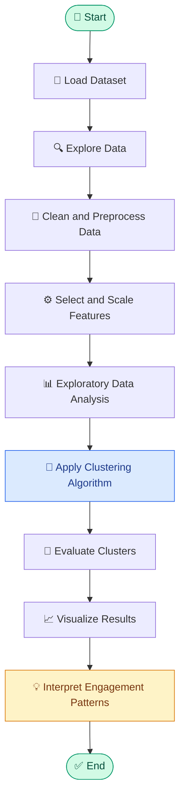

# 📊 Facebook Post Engagement Clustering

### 🤖 Machine Learning | Social Media Analytics | Unsupervised Learning

**👨‍💻 Author:** Soham Nalawade

## 🌟 About the Project

Facebook Post Engagement Clustering is a Machine Learning project that analyzes Facebook post engagement data and groups posts with similar interaction patterns using clustering algorithms.

The project explores engagement metrics such as likes, comments, and shares to identify patterns in audience interaction. Using Python and data analysis techniques, it demonstrates how unsupervised learning can help categorize posts and support social media content analysis.

## 🎯 Objectives

- 📈 Analyze Facebook post engagement data.
- 🧹 Clean and preprocess the dataset.
- 🔍 Identify patterns in audience interactions.
- 🤖 Apply clustering algorithms to group similar posts.
- 📊 Visualize engagement patterns.
- 💡 Generate insights for content performance analysis.

## 🛠️ Technologies Used

| Technology | Purpose |
|---|---|
| Python | Programming language |
| Pandas | Data manipulation and analysis |
| NumPy | Numerical computations |
| Matplotlib | Data visualization |
| Seaborn | Statistical visualization |
| Scikit-learn | Machine learning and clustering |
| Jupyter Notebook | Development and experimentation |

## 📂 Dataset

The project uses a Facebook post engagement dataset containing post information and interaction metrics.

Possible features include:

- 👍 Likes and reactions
- 💬 Comments
- 🔁 Shares
- 📝 Post type, such as photos, videos, or links
- ⏰ Publishing date or time
- 📣 Reach or impressions, if available

The exact features depend on the dataset used in the implementation.

## 🔄 Project Workflow

The following flowchart illustrates the project pipeline.



## ⚙️ Project Methodology

### 1. 📥 Data Collection
Load the Facebook engagement dataset from a CSV file or another supported source.

### 2. 🧹 Data Preprocessing
- Check for missing and duplicate values.
- Handle inconsistent records.
- Select relevant engagement features.
- Scale numerical features when appropriate.

### 3. 🔍 Exploratory Data Analysis
Analyze engagement distributions, feature relationships, and differences between post types using charts and statistical summaries.

### 4. 🤖 Clustering
Apply an unsupervised learning algorithm to group posts based on similarities in their engagement characteristics.

### 5. 📏 Model Evaluation
Evaluate the clustering results using suitable metrics and visualizations.

### 6. 📊 Insights
Interpret the resulting clusters to understand similarities and differences in post engagement.

## 🧠 Machine Learning Algorithm

**K-Means Clustering** is a suitable algorithm for this project.

K-Means divides data points into a predefined number of clusters by assigning each point to its nearest centroid and iteratively updating the centroids.

Possible engagement groups may include:

- 🟢 **High Engagement:** Posts with comparatively high interaction.
- 🟡 **Medium Engagement:** Posts with moderate interaction.
- 🔴 **Low Engagement:** Posts with comparatively low interaction.

These labels are interpretations of the resulting clusters, not predefined categories. Actual results depend on the dataset and clustering implementation.

Other algorithms, such as DBSCAN and Hierarchical Clustering, can be explored for comparison.

## 📐 Evaluation Metrics

- **Silhouette Score:** Measures cluster cohesion and separation.
- **Inertia:** Measures within-cluster squared distances for K-Means.
- **Elbow Method:** Helps select a reasonable number of clusters.
- **Cluster Visualization:** Helps interpret group separation and engagement patterns.

## 📊 Expected Output

The project is intended to produce:

- 📌 Cluster assignments for Facebook posts.
- 📈 Visualizations of engagement patterns.
- 🔍 Comparisons between engagement groups.
- 💡 Insights into similarities between posts.

Actual results depend on the dataset, selected features, and implemented algorithm.

## 💼 Applications

- 📱 Social media analytics
- 📊 Content performance analysis
- 🎯 Audience engagement research
- 📝 Content strategy planning
- 📈 Engagement pattern identification
- 🤖 Unsupervised machine learning practice

## 🚀 Future Improvements

- Compare multiple clustering algorithms.
- Optimize the number of clusters.
- Include additional post attributes.
- Build an interactive dashboard using Streamlit.
- Analyze engagement trends over time.
- Generate visual reports for cluster comparison.

## 📁 Project Structure

A typical repository may contain the following files:

```text
Facebook-Post-Engagement-Clustering/
│
├── README.md
├── dataset.csv
├── facebook_engagement_clustering.ipynb
└── requirements.txt
```

**Note:** These are example filenames. Keep only the files that actually exist in your repository.

## 💻 Getting Started

### 📋 Prerequisites

- Python 3.9 or a compatible version
- pip
- A Facebook post engagement dataset
- Jupyter Notebook or another Python development environment

### 📥 Installation

**1. Clone the repository**

```bash
git clone https://github.com/YOUR-GITHUB-USERNAME/Facebook-Post-Engagement-Clustering.git
```

**2. Navigate to the project directory**

```bash
cd Facebook-Post-Engagement-Clustering
```

**3. Install dependencies**

If your repository contains a `requirements.txt` file, run:

```bash
pip install -r requirements.txt
```

Alternatively, install the core libraries:

```bash
pip install pandas numpy matplotlib seaborn scikit-learn jupyter
```

**4. Run the project**

Start Jupyter Notebook:

```bash
jupyter notebook
```

Open the project notebook, verify the dataset path, and execute the cells in order.

## 👨‍💻 Author

**Soham Nalawade**

🎓 Third-Year Artificial Intelligence and Data Science Student

## 🏁 Conclusion

Facebook Post Engagement Clustering demonstrates how unsupervised machine learning can be used to discover patterns in social media engagement data. The project provides practical experience in data preprocessing, clustering, evaluation, and visualization while exploring how posts can be grouped according to engagement characteristics.

## ⚠️ Disclaimer

This project is intended for educational purposes. Clustering results depend on data quality, feature selection, preprocessing, and algorithm settings. Identified patterns do not prove that a particular posting strategy causes higher engagement.
